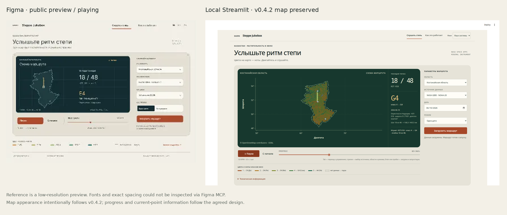

# Задача #16 — локальный Minimal Instrument

Отчёт локальной приёмки интерфейса v0.5.0 на базе v0.4.2, выполненной
в ветке `issue-16-minimal-instrument`. Пользователь подтвердил запуск,
работу кнопок и стрелок и разрешил объединение с `main` и выпуск.
Сведения о релизе: [RELEASE_0.5.0.md](RELEASE_0.5.0.md).

## Что реализовано

- В существующем Streamlit-компоненте остаются один плеер и одни часы
  `audio.currentTime`. Перенесены композиция Minimal Instrument, спокойный
  фон, акцентные кнопки, компактная легенда и раздел «Как это работает».
- По согласованному исключению карта сохраняет представление v0.4.2:
  реальные изображения NASA, географические оси, сетку, контур, «+»,
  текущую клетку и пройденный путь. Будущий путь остаётся скрытым.
- Рядом с картой показаны позиция, ID, нота, класс, дата, координаты
  и расстояние текущей точки. Подтверждённый пропуск обозначается символом
  `∅`, текстом «нет данных → пауза» и пунктирным разделителем.
  Ожидание или ошибка загрузки не выдаются за отсутствие NDVI.
- Перемотка доступна нажатием на шкалу, перетаскиванием маркера и касанием.
  Кнопки «←»/«→» перемещают на один шаг (0,5 с); клавиши ←/→ работают
  и без фокуса на шкале. Поля выбора, вкладки и техническая таблица сохраняют
  обычную обработку стрелок. На шкале Home/End переводят в начало/конец.
  Пока данные не готовы, кнопки недоступны; на границах трека соответствующая
  кнопка отключается.
  Пауза сохраняется; играющая дорожка продолжает звучать с выбранного
  времени. Карта, след, дата путешествия, карточка и таблица используют
  ту же позицию. После перемотки назад предстоящий путь вновь скрывается.
- Таблица, диагностика, дополнительные слои и управление кэшем находятся
  в закрытой по умолчанию «Технической информации». Инспекция точки
  на карте раскрывает этот блок. Изменение источника, даты, области,
  режима или слоёв по-прежнему останавливает и сбрасывает плеер.
- Сохранены ru/kk/en, клавиатура, видимый фокус и доступные названия.
  Основные элементы помещаются в окно 1920×1080 при масштабе 100%.
  На смартфоне разрешена вертикальная прокрутка; горизонтальной нет.

## Макет и снимки

[Рабочий макет Figma](https://www.figma.com/design/Z55JjoPbXmO2SsuCETTjvw/Steppe-Jukebox-%E2%80%94-Minimal-Instrument).
Доступно публичное превью. Чтение слоёв MCP заблокировано лимитом Starter;
точные шрифты и отступы из исходных слоёв проверить не удалось.
Компоновка сверялась с превью с учётом согласованного сохранения карты.



Полноразмерные локальные снимки:

- [Готовность к запуску](media/v0.5.0/desktop-ready.png).
- [Воспроизведение](media/v0.5.0/desktop-playing.png).
- [KST-006: нет данных](media/v0.5.0/desktop-gibs-gap.png).
- [NASA EIC за 20 апреля](media/v0.5.0/desktop-eic.png).
- [Как это работает](media/v0.5.0/desktop-method.png).
- [Смартфон 390 px: настройки](media/v0.5.0/mobile-390.png)
  и [управление](media/v0.5.0/mobile-390-controls.png).
- [Смартфон 320 px: управление](media/v0.5.0/mobile-320-controls.png).

Снимки и краткие сводки приёмки сохранены в `docs/media/v0.5.0`.
Полные локальные артефакты и XML-результаты тестов остаются в игнорируемых
папках `artifacts/issue16` и `test-results`. Снимки до выпуска сохраняют
номер базовой версии v0.4.2; снимки кандидата v0.5.0 приведены в отчёте релиза.

## Локальная приёмка

На реальных данных из изолированной копии подготовленного пользовательского
кэша проверены:

- Костанай → NASA GIBS → **10 июня 2026**: 48 точек, 24 с. При обычном
  воспроизведении на 2,55–2,95 с карта и карточка показывали **KST-006**,
  индекс 5 и «нет данных → пауза», аудио оставалось в состоянии playing.
  Проверка PCM подтвердила нулевые отсчёты на всём интервале **2,5–3,0 с**.
- NASA EIC → **20 апреля 2026**: загрузка, запуск, повторная загрузка
  из кэша и сброс без автозапуска. В обоих случаях 48 точек и 24 с.
- В указанных сценариях сетевых запросов **0**; внешние HTTP-запросы
  были запрещены. Холодная загрузка NASA в этом изменении не повторялась.
- Основные элементы действительно находятся внутри viewport 1920×1080.
  На 390/320 px нет горизонтального переполнения, кнопки доступны.
  В эмуляции смартфона проверены касание шкалы и запуск/пауза касанием.
- При одинаковых размерах 720×430 SVG карты с KST-006 полностью совпал
  с SVG v0.4.2, включая координаты, изображения, оси и подсветку.
  `grid_map.js`, загрузчики, маршруты и звуковые правила не менялись.

Сводки: [реальные данные](media/v0.5.0/real-checks.json),
[сохранение карты](media/v0.5.0/map-preservation.json).
Ошибок JavaScript в проверенных реальных сценариях не обнаружено.

Автоматические проверки:

- 54 проверки переводов, звука и загрузчиков GIBS/EIC — пройдены.
- 19 целевых браузерных сценариев — пройдены: перемотка мышью и клавиатурой, сохранение
  паузы/воспроизведения, переход через конец, перемотка путешествия между
  датами, сброс следа, смена источника, навигация, три языка, отсутствие
  горизонтальной прокрутки, ошибки источника, каталог и очистка кэша.
- 11 регрессионных сценариев — пройдены: географические оси обеих областей
  на desktop/mobile, выбор языка браузером, клавиатура и доступность легенды.
  Итого 30 различных браузерных сценариев; повторные проверки исправлений
  в это число не включены.

XML-результаты находятся в `test-results/issue16-data-unit.xml`,
`test-results/issue16-browser-final.xml`, `test-results/issue16-regression.xml`
и `test-results/issue16-locale-fixes.xml` (три исправленных английских сценария
из регрессионного прогона).

Полный набор тестов проекта не запускался. Проверки на смартфоне выполнены
в Chromium с эмуляцией viewport и touch, отдельное физическое устройство
и экранный диктор не проверялись. Загрузка всего реального путешествия NASA
на все даты не выполнялась; смена даты при перемотке проверена на
контролируемых ответах источников.

## Запуск

Из корня репозитория:

```bash
.venv/bin/python -m streamlit run app.py \
  --server.address 127.0.0.1 --server.port 8516 \
  --server.headless true --browser.gatherUsageStats false
```

Открыть http://127.0.0.1:8516. Для контрольной паузы выбрать Костанайскую
область, NASA GIBS и 10.06.2026, нажать «Загрузить маршрут», затем «Запустить».
Ввод даты или смена источника не запускают звук автоматически.

Команды автоматической проверки:

```bash
.venv/bin/python -m pytest \
  tests/test_locales.py tests/test_sound.py tests/test_gibs.py tests/test_eic_live.py -q

STEPPE_BROWSER_EXECUTABLE=/snap/chromium/current/usr/lib/chromium-browser/chrome \
.venv/bin/python -m pytest -m browser \
  tests/test_minimal_instrument.py tests/test_ui_navigation.py tests/test_live_browser.py -q
```

Для регрессии дополнительно запускались:
`tests/test_browser.py::test_layout_and_accessible_scale_on_desktop_and_mobile`,
`tests/test_browser.py::test_keyboard_season_start_pause_and_resume`,
`tests/test_browser.py::test_default_language_comes_from_browser_locale`,
`tests/test_region_browser.py::test_both_region_boundaries_and_routes_share_localized_coordinate_axes`.
При другом расположении Chromium заменить `STEPPE_BROWSER_EXECUTABLE`.

## Дополнение: кнопки пошаговой перемотки

Добавлены кнопки назад/вперёд и общие клавиши ←/→, сохранены пауза
и воспроизведение. Добавлен браузерный сценарий кнопок, границ, клавиатуры
и отсутствия конфликта с полями/вкладками; расширены проверки готовности
и мобильной компоновки. Пройдены 7 браузерных сценариев и 3 проверки
переводов. На реальном кэше GIBS кнопками достигнута KST-006 на 2,5 с;
карта, карточка и пауза согласованы. Результаты:
`test-results/issue16-step-controls.xml`.

[Экран с кнопками](media/v0.5.0/desktop-step-controls.png) ·
[Кнопки на смартфоне 320 px](media/v0.5.0/mobile-step-controls-320.png).
