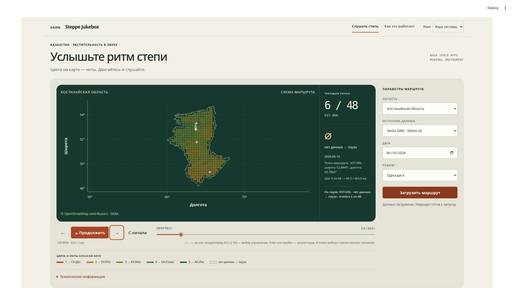
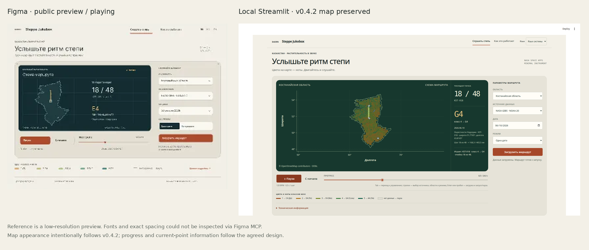

# Выпуск v0.5.0 — Minimal Instrument

15 ноября 2026, Asia/Qostanay. Интерфейс Minimal Instrument и синхронная
перемотка в существующем Streamlit-плеере. Выпуск подготовлен поверх v0.4.2
по [задаче #16](https://github.com/DAIRN-Universe/steppe-jukebox/issues/16).
Пользователь подтвердил локальную работу приложения, кнопок и стрелок,
после чего разрешил объединение с `main` и публикацию v0.5.0 в GitHub.

## Изменения

- Новая компоновка плеера, карточка текущей точки и компактная легенда.
  Карточка показывает позицию, ID, ноту, класс, дату, координаты и расстояние.
- По согласованному решению карта сохраняет вид и поведение v0.4.2:
  изображения NASA, контур, оси, сетку, «+», текущую клетку и пройденный путь.
  Предстоящий путь скрыт. Карта и звук используют одни аудиочасы.
- Перемотка нажатием на шкалу, перетаскиванием маркера и касанием.
  Кнопки ←/→ и клавиши ←/→ перемещают на один шаг (0,5 с).
  На шкале Home/End переводят в начало/конец. Пауза сохраняется,
  играющий трек продолжает звучать с выбранного времени. Дата путешествия,
  карта, след, таблица и карточка обновляются синхронно.
- Поля выбора, вкладки и техническая таблица сохраняют обычные стрелки.
  Кнопки шага отключены до готовности данных и на соответствующей границе.
- Таблица, диагностика загрузки, дополнительные слои и управление кэшем
  свёрнуты в «Техническую информацию». Пропуск NDVI различим по тексту
  «нет данных → пауза», символу ∅ и пунктирному разделителю, кроме цвета.
- Основные элементы помещаются в окно 1920×1080 при масштабе 100%.
  На 390/320 px доступны основные кнопки, нет горизонтальной прокрутки.
  Сохранены ru/kk/en, клавиатура, видимый фокус и два раздела приложения.

Загрузчики GIBS/EIC, пользовательский кэш, маршруты, правила классификации,
ноты, темп, WAV и исходные наборы данных не менялись. Смена источника,
области, даты, режима или слоёв останавливает и сбрасывает плеер без
автозапуска. Смена языка или раздела сохраняет звук и пользовательскую паузу.

## Приёмка и проверки

В процессе разработки пройдены 54 целевые проверки переводов, звука
и загрузчиков и 31 различный браузерный сценарий. Отдельно проверены
кнопки шага и курсорные клавиши, сохранение паузы/воспроизведения,
перемотка между датами путешествия, сброс следа, ошибки источника,
навигация, обе области, три языка и мобильная компоновка.

После установки номера **0.5.0** повторно пройдены:

- 12 проверок локализаций и звука.
- 7 браузерных сценариев перемотки, кнопок/стрелок, GIBS/EIC,
  компоновки 1920×1080 и трёх языков на 390/320 px.
- `pip check`: конфликтов зависимостей нет.

На готовом кандидате с номером **v0.5.0** в интерфейсе проверены реальные
данные из изолированной копии подготовленного кэша, с запретом внешних HTTP:

- **Костанай → GIBS → 10.06.2026**: 48 точек / 24 с. На KST-006
  карта, индекс 5, карточка и статус показывают «нет данных». PCM на всём
  интервале **2,5–3,0 с** содержит нулевые отсчёты. Кнопками достигнута
  позиция 2,5 с; проверены курсорные клавиши и продолжение воспроизведения.
- **EIC → 20.04.2026**: загрузка, запуск и повторная загрузка из прогретого
  кэша. В обоих случаях 48 точек / 24 с и **0 сетевых запросов**.
- Кнопки, карта, текущая точка и настройки находятся внутри viewport
  1920×1080. На 390/320 px проверены три языка, кнопки минимум 44×44 px
  и отсутствие горизонтального переполнения. Ошибок JavaScript нет.

Ранее при одинаковом размере 720×430 SVG карты с KST-006 полностью
совпал с SVG v0.4.2. `grid_map.js` сохранён побайтно.

[Сводка проверки кандидата](media/v0.5.0/release-checks.json) ·
[Сохранность карты](media/v0.5.0/map-preservation.json) ·
[Подробная локальная приёмка](ISSUE_16_LOCAL.md).
Локальные XML-результаты: `test-results/release-0.5.0-unit.xml`
и `test-results/release-0.5.0-browser.xml`.

## Снимки



[Смартфон 320 px](media/v0.5.0/release-mobile-320.png).
Сравнение с кадром Figma на этапе локальной приёмки:



Дизайн сверялся с публичным превью Figma. Чтение слоёв MCP было ограничено
лимитом Starter, поэтому точные шрифты и отступы исходного файла отдельно
не подтверждены. Сохранение карты v0.4.2 — согласованное исключение из макета.

## Запуск

Python 3.11 или новее, из корня репозитория:

```bash
python3 -m venv .venv
source .venv/bin/activate
python -m pip install -r requirements.txt
python -m streamlit run app.py
```

Открыть http://localhost:8501. Выбрать область, источник и точную дату,
нажать «Загрузить маршрут», затем «Запустить». Для контрольной паузы:
Костанайская область, NASA GIBS, 10.06.2026, точка KST-006 на 2,5–3,0 с.

Явный режим прежних сохранённых CSV:

```bash
STEPPE_SAVED_REGIONS=1 python -m streamlit run app.py
```

Подробнее: [LOCAL_DEMO.md](LOCAL_DEMO.md).

## Границы проверки

Полный набор тестов проекта повторно не запускался. Холодная загрузка NASA
в этом выпуске не повторялась; её прежние замеры относятся к v0.4.0.
Мобильные проверки выполнены в Chromium с эмуляцией viewport и touch;
физический смартфон и экранный диктор отдельно не проверялись.
Полное реальное путешествие на все даты NASA не загружалось; смена даты
при перемотке проверена на контролируемых ответах источников.

Ограничения шкал GIBS/EIC и доступности дат сохраняются. NDVI описывает
зелёность, а не виды растений или причины изменений. Путешествие одновременно
меняет место и дату и не доказывает временной тренд. Произвольный маршрут
остаётся отдельным этапом #14. MANIFESTO, LICENSE и выпущенные данные сохранены.
