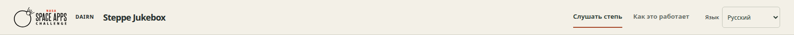
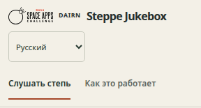

# Выпуск v0.5.1 — логотип Space Apps

15 ноября 2026, Asia/Qostanay. Небольшое обновление оформления поверх v0.5.0:
в верхней строке перед DAIRN размещён логотип NASA Space Apps Challenge.

Использован предоставленный файл `Space Apps Logo Color and Black.svg`.
Его содержимое скопировано в `steppe_jukebox/frontend/assets/space-apps-logo.svg`
без изменений. SHA-256 исходника и файла в приложении совпадает:
`9be813dd6a6c22f45a3243d9e2b044da7f4466de9f186d1f731124e0fb953d9d`.

Логотип загружается как локальный SVG, без обращения к внешним серверам.
Пропорции 561:221 сохранены; ширина составляет 106 px на компьютере
и 64 px на смартфоне, высота вычисляется автоматически. Задано доступное
название через `alt`. Карта, звук, загрузчики, перемотка и кнопки v0.5.0
не менялись.

## Проверка

- Логотип успешно загружается и находится перед DAIRN.
- Проверены ru/kk/en на ширинах 1920, 1440, 768, 390 и 320 px —
  15 сочетаний ширины и языка. Нет горизонтального переполнения.
- Основные элементы по-прежнему помещаются в 1920×1080.
- В интерфейсе отображается номер v0.5.1, ошибок JavaScript нет.
- Три существующих теста локализаций пройдены.

Полный набор тестов повторно не запускался: изменение касается шапки
и номера версии. Приёмка звука и карты остаётся описанной в
[RELEASE_0.5.0.md](RELEASE_0.5.0.md).

[Сводка проверки](media/v0.5.1/checks.json).





## Запуск

```bash
python -m streamlit run app.py
```

Открыть http://localhost:8501. Подробности установки и управления:
[LOCAL_DEMO.md](LOCAL_DEMO.md).
