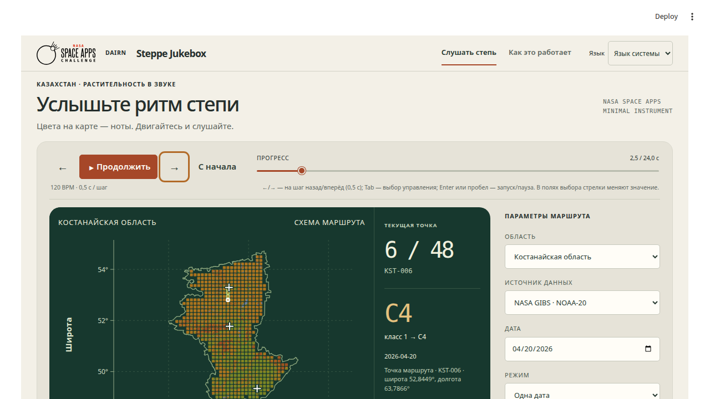

# Выпуск v0.5.2 — компактная высота плеера

15 ноября 2026, Asia/Qostanay. Исправление компоновки поверх v0.5.1:
при небольшой высоте окна кнопки управления больше не находятся под картой.
Пользователь подтвердил локальный результат и разрешил объединение с `main`
и публикацию v0.5.2.

## Изменения

- Строка управления — запуск/пауза, шаг назад/вперёд, «С начала» и шкала
  перемотки — находится над картой и настройками. На узком экране она также
  предшествует настройкам, поэтому они не вытесняют кнопки ниже карты.
- Сокращены вертикальные отступы шапки и заголовка. Боковые поля Streamlit
  адаптируются к ширине окна, сохраняя пространство для содержимого.
  Безопасный верхний отступ от панели Streamlit сохранён: логотип не перекрыт.
- На вкладке «Как это работает» и на экране ошибки данных строка управления
  скрыта. Смена вкладок сохраняет воспроизведение или пользовательскую паузу.
- Вид и отрисовка карты, исходный SVG-логотип, звук, загрузчики NASA,
  кэш и данные не менялись. Кнопки шага, стрелки, перемотка и состояния
  отсутствия данных сохраняют поведение v0.5.1.

## Проверки

После установки номера **v0.5.2** пройдены:

- 12 целевых браузерных сценариев: видимость управления при небольшой высоте,
  три языка, перемотка, кнопки/стрелки, GIBS/EIC, мобильная компоновка,
  сохранение аудиочасов при навигации и экран ошибки данных.
- 3 существующих проверки локализаций; проверка синтаксиса JavaScript.

Для окна 1280×720 проверены эффективные CSS-области, соответствующие
масштабу браузера 100%, 125% и 150%: 1280×720, 1024×576 и 853×480.
В каждом случае кнопки и шкала находятся внутри видимой области без
прокрутки страницы от её верхнего края. Для увеличенного масштаба использованы
CSS-viewport и соответствующий device scale factor; реальные сочетания
масштаба браузера и системного масштабирования отдельно не перебирались.

На реальном подготовленном кэше GIBS за 20.04.2026 подтверждены номер
v0.5.2, переход кнопками к KST-006 на 2,5 с, согласованность карты/карточки,
переход вперёд и возврат стрелкой без автозапуска. Внешние HTTP-запросы
в этом прогоне запрещены, ошибок JavaScript нет.

Сохранены проверка 1920×1080 и мобильные размеры 390/320 px на ru/kk/en,
доступность основных кнопок и отсутствие горизонтального переполнения.
На коротком или увеличенном экране для просмотра остальной карты, настроек
и технической информации может потребоваться вертикальная прокрутка.

[Сводка проверки кандидата](media/v0.5.2/checks.json).
Локальные результаты тестов: `test-results/release-0.5.2-browser.xml`
и `test-results/release-0.5.2-locales.xml`.
Полный набор тестов повторно не запускался. Границы проверки данных NASA
и доступности сохраняются из [v0.5.0](RELEASE_0.5.0.md).

## Снимки

1280×720, масштаб 100%:



[Эквивалент масштаба 125%](media/v0.5.2/1280x720-125.png) ·
[Эквивалент масштаба 150%](media/v0.5.2/1280x720-150.png).

## Запуск

```bash
python -m streamlit run app.py
```

Открыть http://localhost:8501. Выбрать параметры, нажать «Загрузить маршрут»,
затем использовать управление над картой. Установка, источники и управление
с клавиатуры: [LOCAL_DEMO.md](LOCAL_DEMO.md).
