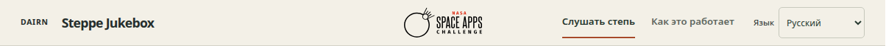
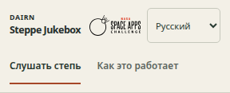

# Выпуск v0.5.3 — логотип в центре шапки

15 ноября 2026, Asia/Qostanay. Логотип Space Apps расположен по центру
верхней шапки независимо от ширины соседних элементов. Пользователь
подтвердил локальный результат и разрешил публикацию обновления.

- DAIRN / Steppe Jukebox находятся слева, логотип — в центре,
  навигация и выбор языка — справа.
- На узких экранах вкладки переходят во вторую строку. Логотип остаётся
  по центру, выбор языка — справа; элементы не перекрывают друг друга.
- Исходный SVG, пропорции и доступное название логотипа сохранены.
  Карта, звук, загрузчики NASA и управление плеером не менялись.

## Проверки

На кандидате **v0.5.3** проверены ru/kk/en на ширинах 1920, 1440, 1280,
1200, 1024, 853, 768, 390 и 320 px — **27 сочетаний**. Центр изображения
совпадает с центром шапки с погрешностью менее 1 px. Наложений,
горизонтального переполнения и ошибок JavaScript нет.

Дополнительно пройдены **4 браузерных сценария** видимости управления
при эффективных масштабах 100%/125%/150% и сохранения аудиочасов при смене
вкладок и языка, а также **3 проверки локализаций**.
Полный набор тестов повторно не запускался. Проверки выполнены в Chromium;
границы приёмки данных и доступности сохраняются из
[v0.5.0](RELEASE_0.5.0.md), проверки компактной высоты — из
[v0.5.2](RELEASE_0.5.2.md).

[Сводка проверки](media/v0.5.3/checks.json).
Локальные XML-результаты: `test-results/release-0.5.3-browser.xml`
и `test-results/release-0.5.3-locales.xml`.





## Запуск

```bash
python -m streamlit run app.py
```

Открыть http://localhost:8501. Установка и управление:
[LOCAL_DEMO.md](LOCAL_DEMO.md).
